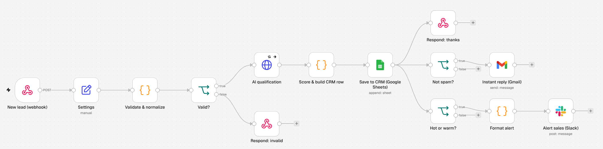
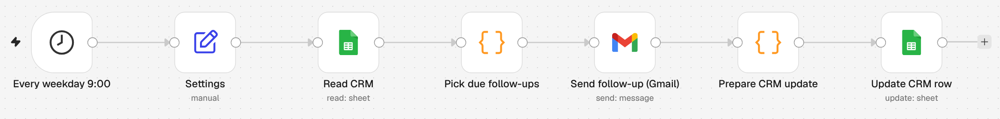

# n8n AI Lead Automation — capture, qualify, reply and follow up in minutes

Three importable **n8n** workflows that turn a website form into a small sales machine:

1. **Lead intake** — a form posts to a webhook; the lead is validated, **scored by AI**, saved to a **Google Sheets CRM**, answered with a **personalised email within a minute**, and hot/warm leads trigger a **Slack alert** for the sales team.
2. **Follow-ups** — every weekday at 9:00, leads that haven't replied get up to two polite follow-up emails, and the CRM is updated.
3. **Error alert** — if anything fails, the team is told in Slack with a link to the failed execution.





## Why businesses want this

- Every lead gets a relevant answer within a minute, 24/7, instead of waiting for someone to check the inbox.
- Salespeople only get pinged for leads worth their time, with a one-line AI summary, budget and urgency.
- Every lead ends up in one sheet with a score, tier and status, ready for reports, with no copy and paste.
- Nobody forgets to follow up.

## What happens to each lead

| Step | Node | Detail |
|---|---|---|
| Capture | Webhook `POST /webhook/new-lead` | Works with the included form, Webflow, WordPress, Typeform, Tally (English or Spanish field names). Honeypot field against bots. |
| Validate | Code | Cleans name, email, phone, message; invalid requests get a `422` with the reasons. |
| Qualify | HTTP Request → any OpenAI-compatible API | Returns `fit_score`, intent, budget, urgency, service, summary and a reply draft as strict JSON. The email address is never sent to the AI. |
| Score | Code | Final score = 75% AI + 25% transparent rules (company email, budget, phone, urgency…). **If the AI is down, the rules score alone keeps everything running.** Spam and job seekers are capped at 10. |
| Store | Google Sheets (append) | One row per lead: score, tier (hot ≥ 70, warm ≥ 40, cold), status, follow-up counters. |
| Respond | Respond to Webhook | The form shows "Thanks!" immediately. |
| Reply | Gmail | Personal reply in the lead's language (AI draft, or a safe template as fallback). Not sent to spam. |
| Alert | Slack | `🔥 HOT lead (86/100): Lucía Fernández — Bodega Andes` + summary, budget, urgency and contact. |

## Tested

- `npm test` runs 19 tests: the business logic, plus **the exact JavaScript stored in each Code node** of the generated workflows, plus structural checks (every connection points to an existing node, unique names and ids, error workflow wired).
- The three workflows were **imported into n8n 2.45.7** and the intake workflow was **executed end to end** against a mock AI server, with the Google Sheets, Gmail and Slack nodes swapped for no-op nodes (those need real accounts): the valid lead came out as a hot lead with its reply and Slack text, and the invalid one took the `422` branch. The same run with the AI server down fell back to the rules score as designed.
- GitHub Actions runs the tests and fails if `workflows/` is out of date with `src/`.

## Set up (about 20 minutes)

1. **Google Sheet:** create a sheet with a tab named `Leads` and paste the header row from [`docs/crm-template.csv`](docs/crm-template.csv).
2. **Import:** in n8n → *Workflows → Import from file* → import `workflows/03-error-alert.json`, then `01-lead-intake.json` and `02-lead-follow-ups.json`.
3. **Credentials:** connect Google Sheets, Gmail and Slack, and create a *Header Auth* credential for the AI provider: name `Authorization`, value `Bearer YOUR_API_KEY`. Select them in the nodes that show a warning.
4. **Settings node** (first node of each workflow): describe the business offer, AI base URL and model (`https://api.openai.com/v1` + `gpt-4o-mini`, or Groq, OpenRouter, Gemini's OpenAI endpoint, a local Ollama…), the sheet URL and the Slack channel.
5. **Activate** the three workflows, copy the webhook's *Production URL* into `form/index.html` (`WEBHOOK_URL`) and publish the form, or point any existing form to that URL.

## Customising for a client

The rules and texts live in [`src/lead-logic.js`](src/lead-logic.js) (score weights, tiers, free-email domains, urgency words, follow-up timing and wording). After editing, run:

```bash
npm test        # rebuilds workflows/ from src/ and runs the tests
```

Common variations: HubSpot, Pipedrive or Airtable instead of Sheets; WhatsApp or Telegram instead of Slack; a calendar link in the reply for hot leads; a weekly summary of leads by source.

## Project structure

```
src/lead-logic.js            # all business logic (validation, AI request, scoring, texts, follow-ups)
scripts/build-workflows.js   # builds the n8n JSON and inlines the logic into the Code nodes
workflows/                   # importable n8n workflows (generated)
form/index.html              # responsive contact form that posts to the webhook
docs/crm-template.csv        # CRM header row
tests/                       # node:test suites
```

## License

MIT
